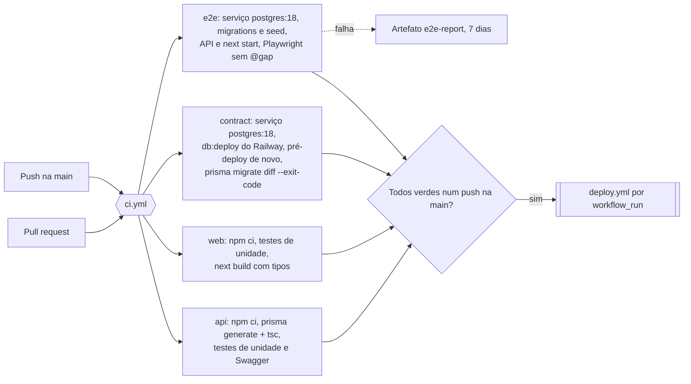
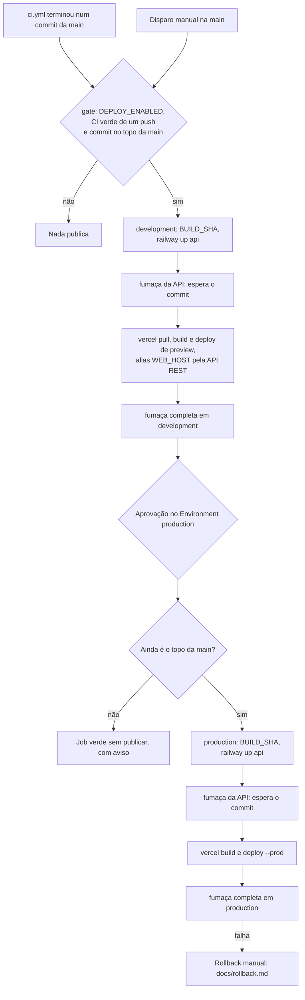

# workflows

Os dois workflows do GitHub Actions: a CI, que testa cada mudança, e a publicação em development e, com aprovação, em production. É a mesma estrutura do pipeline do AI-Chat, adaptada a este monorepo. O `evals.yml` de lá não tem par aqui, porque este projeto não usa IA.

## Arquivos

| Arquivo                    | O que faz                                                                                                                                                                                                                                                                                                                                                                   | Quem usa                                                    |
| -------------------------- | --------------------------------------------------------------------------------------------------------------------------------------------------------------------------------------------------------------------------------------------------------------------------------------------------------------------------------------------------------------------------- | ----------------------------------------------------------- |
| [`ci.yml`](ci.yml)         | Quatro jobs em paralelo: `api` (Prisma Client, build com o tsc e testes de unidade), `web` (testes de unidade e o build do Next, que confere os tipos), `contract` (migrations do zero, o pré-deploy do Railway e o schema igual às migrations, num Postgres 18 descartável) e `e2e` (a suíte estável do Playwright contra a API e o web de verdade, com migrations e seed) | Toda pull request e todo push na `main`                     |
| [`deploy.yml`](deploy.yml) | Depois da CI verde num push na `main`: `gate`, `development`, aprovação e `production`, no Railway e na Vercel, com a fumaça depois da API e depois do web                                                                                                                                                                                                                  | O `workflow_run` do `ci.yml`, ou o disparo manual na `main` |
| `README.md`                | Este arquivo                                                                                                                                                                                                                                                                                                                                                                |                                                             |

Fora desta pasta:

| Arquivo                                                                        | O que faz                                                                                                                                                                                                                                                                                                                                                                                                | Quem usa                                                                                                       |
| ------------------------------------------------------------------------------ | -------------------------------------------------------------------------------------------------------------------------------------------------------------------------------------------------------------------------------------------------------------------------------------------------------------------------------------------------------------------------------------------------------- | -------------------------------------------------------------------------------------------------------------- |
| [`../scripts/smoke.mjs`](../scripts/smoke.mjs)                                 | Fumaça de um ambiente publicado. Espera até 10 minutos o `/api/health` devolver o commit, confere `/api/health/ready` (banco), `X-Request-Id`, os cabeçalhos do helmet, o 401 de `/api/auth/me` sem token e o Swagger fechado. Com `--web`, confere `/` e `/login`, o JavaScript do web chamando esta API e o CORS da API aceitando a origem do web e recusando outra. Sai com 1 e a lista do que falhou | Os dois jobs do `deploy.yml` e quem opera no fim de um rollback ([`docs/rollback.md`](../../docs/rollback.md)) |
| [`../../playwright.ci.config.ts`](../../playwright.ci.config.ts)               | A `playwright.config.ts` mais os dois servidores (API com `node dist/server.js` e web com `next start`), com os valores do ambiente Docker. Recusa rodar fora da CI                                                                                                                                                                                                                                      | O job `e2e`                                                                                                    |
| [`../../apps/web/vercel.json`](../../apps/web/vercel.json)                     | Desliga a publicação da Vercel por Git: o web só sai pelo `deploy.yml`                                                                                                                                                                                                                                                                                                                                   | A Vercel                                                                                                       |
| [`../../apps/api/src/lib/build-info.ts`](../../apps/api/src/lib/build-info.ts) | O commit da versão no ar, que o `/api/health` devolve em `build`: o `apps/api/BUILD_SHA` gravado pelo deploy ou, sem ele, o `RAILWAY_GIT_COMMIT_SHA`                                                                                                                                                                                                                                                     | A rota de health e a fumaça                                                                                    |

## CI

Os jobs não dependem uns dos outros e nenhum lê segredo, então rodam igual em pull requests do Dependabot e de forks. O E2E sorteia na hora o `JWT_SECRET` da API e a `SEED_PASSWORD` das contas do seed, e mascara os dois no log. O nome `ci` é o que o `deploy.yml` escuta.

Ficaram de fora, por enquanto: o lint (o `npm run lint` dos dois apps não roda: ESLint 9 sem `eslint.config`, e o `next lint` abre um prompt) e o Prettier (`npm run format:check` acusa 19 arquivos). Quando os dois passarem na máquina, entram como um passo nos jobs `api` e `web`.

## Deploy

O `deploy.yml` faz checkout do commit que a CI testou, não do topo da `main` no momento. O `gate` e a nova conferência depois da aprovação impedem que uma CI antiga, ou uma aprovação de dias atrás, devolva código velho ao ar. Cada ambiente tem o próprio grupo de concorrência, então uma aprovação pendente de production não segura o development.

A API sobe primeiro e a fumaça espera o `/api/health` responder com o commit novo; só então o web sai. Assim um web que depende de rota nova nunca fica no ar falando com a API antiga, e um deploy de API que falhou (no build, no pré-deploy das migrations ou no health check) para o pipeline antes do web.

O que o `railway up` usa é a configuração gravada no serviço `api` de cada ambiente: Railpack, build `npm ci && npm run build --workspace=api`, pre-deploy `npm run db:deploy --workspace=api` (a checagem só de leitura do `apps/api/scripts/predeploy-check.mjs` e o `prisma migrate deploy`), start `npm run start --workspace=api` e health check em `/api/health`. O `Postgres` de cada ambiente não passa pelo deploy.

## Segredos e variáveis

Guardados em cada GitHub Environment (`development` e `production`), que só aceitam a `main`:

| Nome                                  | Tipo              | Para que serve                                                                                                                                                               |
| ------------------------------------- | ----------------- | ---------------------------------------------------------------------------------------------------------------------------------------------------------------------------- |
| `RAILWAY_TOKEN`                       | Segredo           | Token do projeto no Railway, limitado ao ambiente. Só o passo do `railway up` o recebe                                                                                       |
| `VERCEL_TOKEN`                        | Segredo           | Token da Vercel com escopo do time, para `pull`, `build`, `deploy` e o alias                                                                                                 |
| `VERCEL_AUTOMATION_BYPASS_SECRET`     | Segredo, opcional | Só quando a proteção de deployments da Vercel cobre o `WEB_HOST` (hoje, qualquer host `*.vercel.app` do projeto). A fumaça o manda no cabeçalho `x-vercel-protection-bypass` |
| `VERCEL_ORG_ID` e `VERCEL_PROJECT_ID` | Variáveis         | O time e o projeto da Vercel                                                                                                                                                 |
| `API_URL`                             | Variável          | Origem `https` da API no Railway, sem barra no fim. Entra no build como `NEXT_PUBLIC_API_URL` e é o `--api` da fumaça                                                        |
| `WEB_HOST`                            | Variável          | Host do web, sem `https://`: o alias de development, o domínio de production e o `--web` da fumaça                                                                           |

A variável de repositório `DEPLOY_ENABLED` liga o pipeline. O Environment `production` tem o dono do repositório como revisor obrigatório.

## Como ligar o pipeline

Uma vez só, nesta ordem. Até o passo 6, um push na `main` roda a CI e o deploy fica de fora.

1. **Branch padrão.** No GitHub, Settings > General > Default branch: trocar `dev` por `main`. O `workflow_run` e o botão de disparo manual só valem para workflows da branch padrão (o Dependabot também lê a configuração de lá).
2. **Railway, ambiente development.** No projeto `Agendamentos`, criar o ambiente `development` duplicando o `production`. No serviço `api` dele: `APP_URL=https://<WEB_HOST de development>`, um `JWT_SECRET` novo, `RESEND_API_KEY` e `S3_*` vazios (e-mail só no log, upload responde 503) e `DATABASE_URL=${{Postgres.DATABASE_URL}}`; manter `NODE_ENV=production` e `SWAGGER_ENABLED` sem valor, como em produção. Em Settings > Networking, gerar o domínio público: ele é o `API_URL` de development. O banco de development começa vazio, e o seed recusa hosts do Railway de propósito.
3. **Railway, origem e tokens.** Em Settings > Source do serviço `api`, nos dois ambientes, desconectar o repositório. Sem isso, um merge na `main` publica a API de produção na hora, sem passar pela aprovação. Em Project Settings > Tokens, criar um token do projeto para `development` e outro para `production`.
4. **Vercel.** Criar um token com escopo do time `tiodevs-projects`. Escolher o host estável de development (por exemplo um `*.vercel.app` livre). Como a proteção de deployments cobre todo host que não é domínio próprio, gerar em Settings > Deployment Protection o segredo de "Protection Bypass for Automation". Em Settings > Environment Variables, deixar o `NEXT_PUBLIC_API_URL` de Preview apontando para a API de development (o workflow já passa o valor certo no build, mas assim um build feito pela Vercel não aponta para produção).
5. **GitHub Environments.** Em Settings > Environments, criar `development` e `production`, os dois com "Deployment branches" só na `main`, e cadastrar os segredos e as variáveis da tabela acima. No `production`, marcar "Required reviewers" com o dono do repositório.
6. **Ligar.** Em Settings > Secrets and variables > Actions > Variables, criar `DEPLOY_ENABLED=true`. Para testar o caminho inteiro, rodar o `deploy` pela aba Actions (Run workflow, na `main`).
7. **Proteção da `main`.** Em Settings > Rules > Rulesets, um ruleset da `main` com pull request obrigatória, os checks `api`, `web`, `contract` e `e2e` obrigatórios e force push bloqueado. Os checks só aparecem na busca depois de rodarem uma vez.

## Como ler

1. `ci.yml`, de cima para baixo: o cabeçalho, os gatilhos e um job por vez. Leia junto o [`playwright.ci.config.ts`](../../playwright.ci.config.ts).
2. `deploy.yml`: o cabeçalho com os segredos, o `gate`, `development` e `production`. Leia junto o [`smoke.mjs`](../scripts/smoke.mjs), que é a prova de cada publicação.
3. [`docs/rollback.md`](../../docs/rollback.md), o caminho de volta.

Conceitos que ajudam:

- **Contêiner de serviço.** O Postgres que o GitHub sobe ao lado do job, com health check antes dos passos e removido no fim.
- **`workflow_run`.** Um workflow que dispara quando outro termina. Ele roda na versão da branch padrão e recebe o commit testado em `github.event.workflow_run.head_sha`.
- **GitHub Environment.** Guarda segredos e variáveis por ambiente, limita as branches e pode exigir aprovação antes do job.
- **`concurrency`.** Um grupo deixa um job por vez; com `cancel-in-progress: false`, o que está rodando termina.
- **`if:` sem função de status.** O GitHub acrescenta `success()`, então `production` só roda depois de `gate` e `development` verdes.

## Testes

- `apps/api/test/build-info.test.ts` confere o commit do `/api/health` (arquivo, variável do Railway e valores recusados) e `apps/api/test/openapi.test.ts` falha se um comentário `@swagger` das rotas tiver erro de YAML.
- Os workflows não têm outro teste automático: a prova é a própria execução, e a fumaça roda no fim de cada etapa do `deploy.yml`.
- Para rodar a fumaça à mão, da raiz do repositório: `node .github/scripts/smoke.mjs --api https://<API_URL> --web https://<WEB_HOST>`, com `--commit <sha>` para esperar uma versão.

## O que ainda falta

- Fixar as actions por SHA (hoje são tags; o Dependabot de `github-actions` já abre as atualizações).
- Guardar em cache os navegadores do Playwright no job `e2e`.
- Lint e Prettier na CI, depois de consertar o ESLint 9 e formatar os 19 arquivos.
- Voltar o web sozinho quando a fumaça de produção falha (hoje o rollback é manual).

## Leia também

- [`e2e/README.md`](../../e2e/README.md): a suíte E2E e o ambiente Docker.
- [`docs/aplicacao.md`](../../docs/aplicacao.md), seção 9: a infraestrutura e as variáveis da API.
- [`docs/rollback.md`](../../docs/rollback.md).
