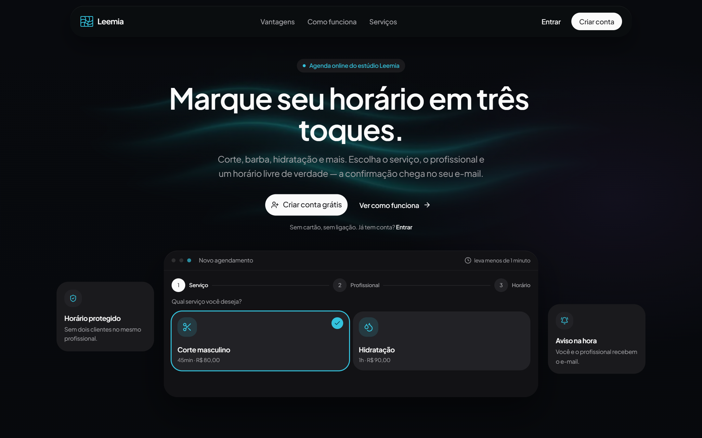
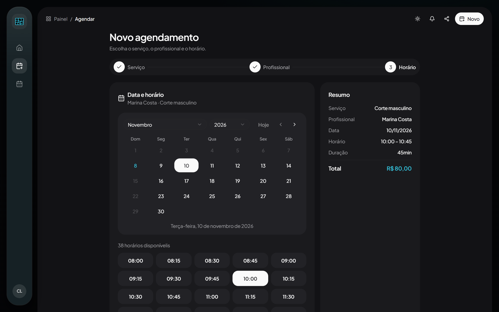
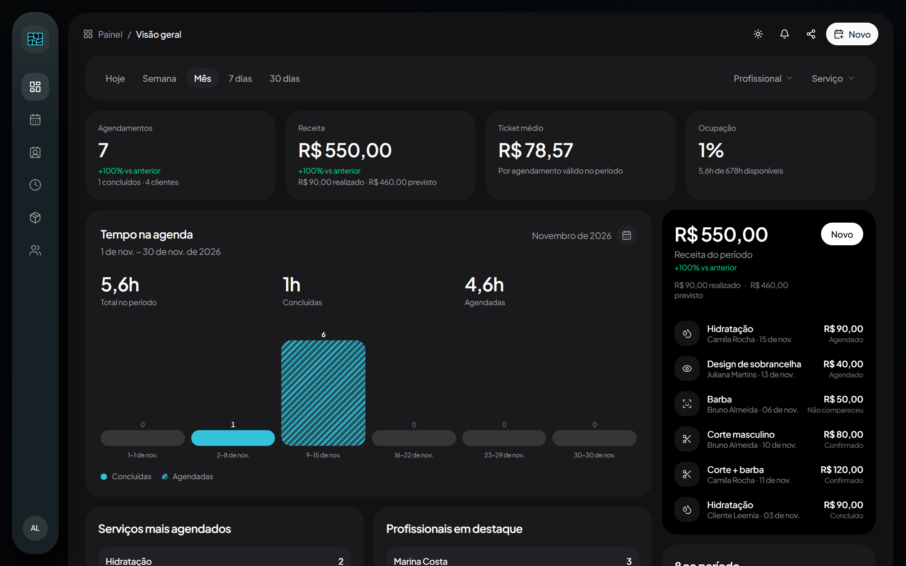
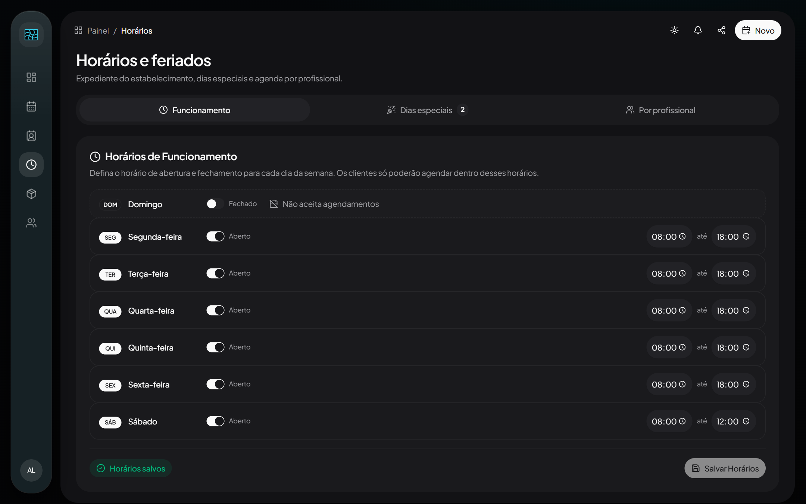
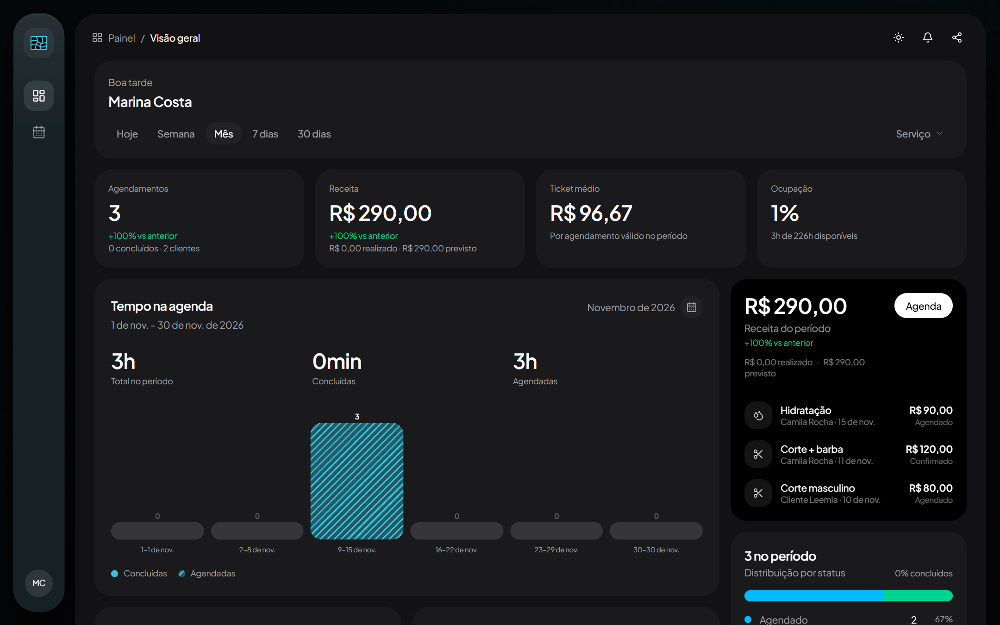
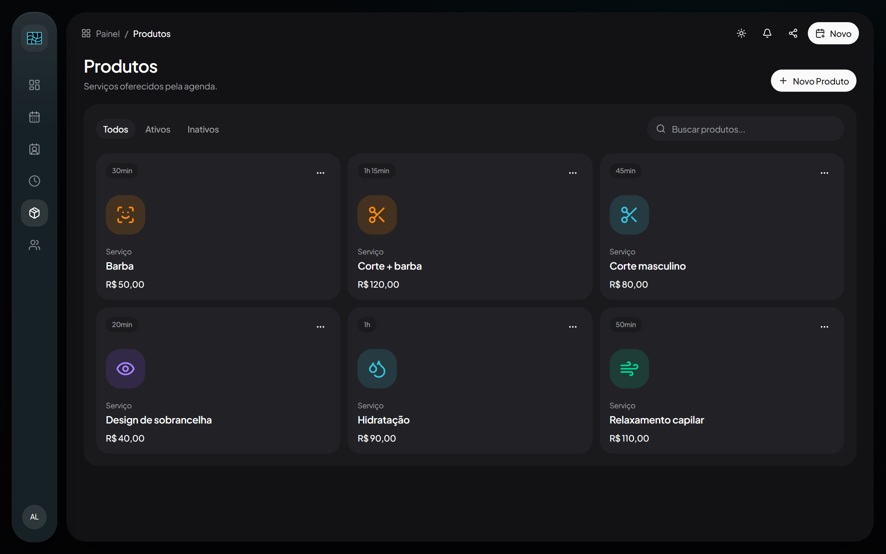
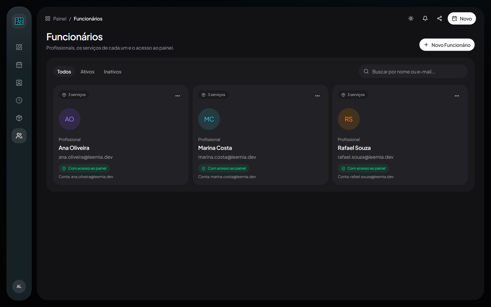
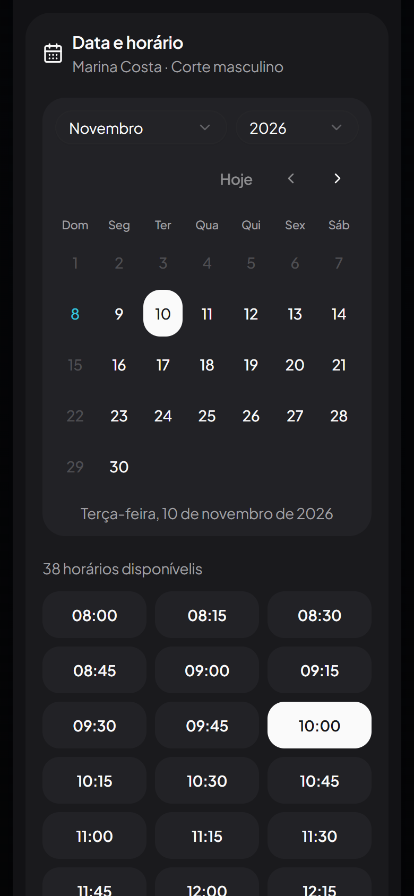
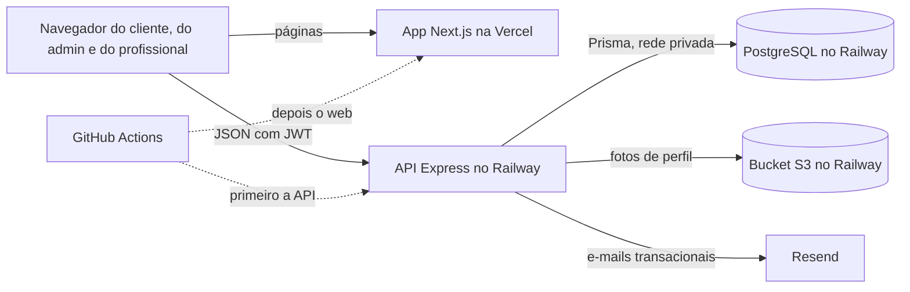

<div align="center">

# Leemia

### Agenda online para estúdios e salões: simples para o cliente, confiável para o estúdio

O cliente marca serviço, profissional e horário em três passos. O estúdio opera agenda, equipe e expediente num painel, e cada profissional acompanha os próprios atendimentos.

[](https://github.com/Tiodevs/sistema-de-agendamentos/actions/workflows/ci.yml)


[](#contribuir)

[Visão geral](#visão-geral) ·
[Telas](#telas) ·
[Como funciona](#por-dentro) ·
[Rodar localmente](#rodar-localmente) ·
[Contribuir](#contribuir) ·
[Licença](#licença) ·
[Ver no ar](https://agendamento.mefelipe.com.br)

<br />



</div>

<br />

## Visão geral

Em muito estúdio, marcar um corte ainda depende de ligação, mensagem e um caderno na recepção. É assim que o mesmo horário acaba vendido duas vezes, o recado se perde e o profissional só descobre a agenda do dia quando chega. A **Leemia** é a agenda online do estúdio: o cliente reserva sozinho, a qualquer hora, e o estúdio opera tudo num painel.

A agenda é a parte que não pode errar:

- **Só aparece horário que existe.** A grade sai do expediente do estúdio e do profissional, em passos de 15 minutos, no horário de São Paulo. Passado, folga, feriado e horário ocupado ficam de fora, e a API recusa qualquer reserva fora dessa grade.
- **Um profissional, um cliente por vez.** A reserva trava a agenda do profissional dentro da transação, e o PostgreSQL recusa a sobreposição com uma constraint própria, mesmo que o código falhe.
- **Cada papel vê o que precisa.** O cliente marca e cancela os próprios horários. O admin cuida de catálogo, equipe, clientes e expediente. O profissional entra por convite e mexe só nos seus atendimentos.
- **Mudança de expediente não pega ninguém de surpresa.** Fechar um dia ou mudar um horário mostra quem seria afetado e pede uma decisão: manter os horários ou cancelar e avisar cada cliente por e-mail, com o motivo.
- **Operação visível.** Painéis com receita realizada e prevista, ocupação, ticket médio e ranking de serviços e profissionais, para o estúdio e para cada profissional.

> [!NOTE]
> Profissionais, clientes, telefones e os e-mails `@leemia.dev` que aparecem nas telas são fictícios: vêm do seed do ambiente Docker, e endereços `@leemia.dev` nunca recebem e-mail. O sistema está em produção em [agendamento.mefelipe.com.br](https://agendamento.mefelipe.com.br).

### Os quatro compromissos

<table>
  <tr>
    <td width="25%" valign="top">
      <h4>📅 Agenda confiável</h4>
      Grade gerada do expediente real, trava por profissional na reserva e constraint <code>EXCLUDE</code> no banco. O mesmo horário não é vendido duas vezes.
    </td>
    <td width="25%" valign="top">
      <h4>🧭 Regras claras</h4>
      Uma máquina de estados única decide o que cliente, profissional e admin podem fazer com cada agendamento, com prazo para cancelar, histórico de cada mudança e “Desfazer” por 10 minutos.
    </td>
    <td width="25%" valign="top">
      <h4>🔐 Segurança</h4>
      Senha com bcrypt, “Sair” derruba todas as sessões da conta, login bloqueado após 5 erros, e-mail confirmado antes de reservar e acesso de profissional só por convite.
    </td>
    <td width="25%" valign="top">
      <h4>✉️ Comunicação</h4>
      Cliente e profissional recebem e-mail quando um horário é marcado ou cancelado, e quem perde o horário por mudança de expediente recebe o motivo.
    </td>
  </tr>
</table>

## Telas

<table>
  <tr>
    <td width="50%" valign="top">
      
      <p align="center"><b>Reserva em três passos.</b> Serviço, profissional e horário. O calendário fecha domingos e dias passados, e a grade mostra só o que está livre.</p>
    </td>
    <td width="50%" valign="top">
      
      <p align="center"><b>Visão geral do estúdio.</b> Agendamentos, receita realizada e prevista, ticket médio e ocupação, filtrados por período, profissional e serviço.</p>
    </td>
  </tr>
  <tr>
    <td width="50%" valign="top">
      
      <p align="center"><b>Horários e feriados.</b> Expediente da semana, dias especiais e agenda própria de cada profissional. O que deixaria cliente sem atendimento pede uma decisão antes de salvar.</p>
    </td>
    <td width="50%" valign="top">
      
      <p align="center"><b>Painel do profissional.</b> Receita, ocupação e próximos atendimentos de quem está logado. Na agenda, ele confirma, inicia, conclui ou registra falta.</p>
    </td>
  </tr>
  <tr>
    <td width="50%" valign="top">
      
      <p align="center"><b>Catálogo.</b> Preço e duração de cada serviço. Serviço com histórico de agendamentos é desativado, nunca apagado.</p>
    </td>
    <td width="50%" valign="top">
      
      <p align="center"><b>Equipe.</b> Os serviços de cada profissional e o estado do acesso ao painel, que só é liberado quando o convite é aceito.</p>
    </td>
  </tr>
</table>

<p align="center">
  
  <br />
  <sub>A área do cliente foi desenhada primeiro para o celular: a mesma reserva, em uma coluna.</sub>
</p>

## O que já funciona

| Área         | O que entrega                                                                                                                                                                                                                   |
| ------------ | ------------------------------------------------------------------------------------------------------------------------------------------------------------------------------------------------------------------------------- |
| Reserva      | Três passos com grade de 15 minutos, preço congelado na hora da reserva, observação opcional e limites para o cliente: até 3 horários futuros e até 60 dias de antecedência                                                     |
| Agenda       | Status por máquina de estados, cancelamento pelo cliente até 2 horas antes (configurável), histórico de cada mudança e “Desfazer” por 10 minutos                                                                                |
| Conta        | Cadastro com confirmação de e-mail, recuperação e troca de senha, troca de e-mail confirmada por link e foto de perfil recortada no navegador                                                                                   |
| Admin        | Visão geral, agenda geral, agendamento em nome do cliente, clientes com histórico, catálogo, equipe com convite e expediente com dias especiais e horário por profissional                                                      |
| Profissional | Painel com métricas próprias e agenda filtrável por período e status, onde confirma, inicia, conclui, cancela ou registra falta                                                                                                 |
| E-mails      | Boas-vindas, confirmação de conta, reserva e cancelamento para cliente e profissional, convite, recuperação e troca de senha e troca de e-mail, pelo Resend                                                                     |
| Segurança    | JWT com versão de sessão, bcrypt, bloqueio de login por e-mail e IP, limites por rota, Helmet, CORS restrito, ID de requisição nos logs e erros sem detalhe interno                                                             |
| Interface    | Tema claro e escuro, área do cliente pensada para o celular e animações que respeitam a preferência por menos movimento                                                                                                         |
| Operação     | Health check com o commit no ar e a prontidão do banco, Swagger, CI em toda pull request, pipeline de deploy com fumaça e aprovação para produção (pronto para ligar), e seed e E2E que se recusam a rodar no banco de produção |

O produto está no ar em [agendamento.mefelipe.com.br](https://agendamento.mefelipe.com.br). Em novembro de 2026 uma auditoria revisou segurança, regras de agenda e operação, e as duas primeiras fases já estão em produção: a Fase 0, com as correções urgentes, e a Fase 1, a da agenda confiável. O que o sistema ainda não faz, como reagendar, lembrar o cliente antes do horário, mostrar a agenda em calendário semanal e cobrar, está nos [backlogs do projeto](Backlogs%20do%20projeto.md).

---

# Por dentro

A partir daqui, a parte técnica. Cada documento responde uma pergunta, em profundidades diferentes:

| Documento                                                                                                    | Responde                                                                                     |
| ------------------------------------------------------------------------------------------------------------ | -------------------------------------------------------------------------------------------- |
| [Documentação técnica](docs/aplicacao.md)                                                                    | Funcionalidades, papéis, rotas da API, modelo de dados, integrações e deploy, numa página só |
| Swagger, em `http://localhost:3001/api/docs`                                                                 | O contrato de cada rota, gerado das JSDoc em [`apps/api/src/routes`](apps/api/src/routes)    |
| [CI e deploy](.github/workflows/README.md) e [rollback](docs/rollback.md)                                    | Como uma mudança chega à produção, como ligar o pipeline e como voltar uma versão            |
| [Testes E2E](e2e/README.md)                                                                                  | Como a suíte de ponta a ponta roda, o que ela cobre e como ela protege o banco               |
| Relatórios de [agendamento](e2e/RELATORIO-INTEGRIDADE.md) e de [autenticação](e2e/RELATORIO-AUTENTICACAO.md) | O que as revisões de segurança e integridade encontraram em cada fluxo                       |
| [Backlogs do projeto](Backlogs%20do%20projeto.md)                                                            | O que ainda não existe e o que vai doer quando o uso crescer                                 |

## Stack

| Camada       | Tecnologia                                                                                                              |
| ------------ | ----------------------------------------------------------------------------------------------------------------------- |
| Frontend     | Next.js 15 (App Router), React 19, TypeScript, Tailwind CSS 4, shadcn/ui, Radix UI, Lucide, Sonner e GSAP               |
| API          | Node.js 20, Express 4, TypeScript, Zod, Helmet, Morgan e Swagger (swagger-jsdoc)                                        |
| Dados        | PostgreSQL com Prisma 7 (`@prisma/adapter-pg`), migrations versionadas e constraint de exclusão contra sobreposição     |
| Autenticação | JWT HS256 com versão de sessão e senhas com bcrypt                                                                      |
| Integrações  | Resend (e-mail transacional) e bucket S3 do Railway (fotos de perfil)                                                   |
| Testes       | `node:test` com tsx nos unitários e Playwright no E2E de API e de interface                                             |
| Qualidade    | ESLint 9 (flat config, com regras de promise solta), Prettier e typecheck no commit, via Husky e lint-staged            |
| Entrega      | GitHub Actions (CI e deploy com aprovação), Vercel (web), Railway (API e PostgreSQL) e Docker Compose no ambiente local |

## Arquitetura



O navegador carrega o app da Vercel e chama a API direto, na URL de `NEXT_PUBLIC_API_URL`, com o token no cabeçalho `Authorization`; o CORS só aceita a origem do front. A API é a única que fala com o banco e concentra toda a regra de negócio, em camadas: rotas com os middlewares de papel, controllers que validam a entrada com Zod, services com as regras e Prisma. A regra mais importante, a de não sobrepor horários do mesmo profissional, vale em dois lugares: no service, que trava a linha do profissional com `FOR UPDATE` antes de gravar, e no PostgreSQL, que recusa a sobreposição com uma constraint `EXCLUDE`.

| Camada | Onde                           | Endereço                                   |
| ------ | ------------------------------ | ------------------------------------------ |
| Web    | Vercel, com root em `apps/web` | https://agendamento.mefelipe.com.br        |
| API    | Railway, serviço `api`         | https://api-production-ac23.up.railway.app |
| Banco  | PostgreSQL no Railway          | só a API acessa, pela rede privada         |

**Entrega.** O pipeline fica no [`deploy.yml`](.github/workflows/deploy.yml): com a CI verde num push na `main`, ele publica a API no Railway e depois o web na Vercel, primeiro em development e, com a aprovação do dono do repositório, em production. Antes das migrations, o Railway roda uma [checagem só de leitura](apps/api/scripts/predeploy-check.mjs) que para o deploy se o banco não estiver pronto. Depois de cada publicação, a [fumaça](.github/scripts/smoke.mjs) espera o `/api/health` responder com o commit novo e confere banco, cabeçalhos de segurança, CORS e o web chamando a API certa. O caminho de volta está em [`docs/rollback.md`](docs/rollback.md).

> [!IMPORTANT]
> O pipeline de deploy ainda está desligado: ele entra no ar com a variável `DEPLOY_ENABLED`, depois dos passos de [como ligar o pipeline](.github/workflows/README.md#como-ligar-o-pipeline). Até lá, vale o caminho anterior: o serviço `api` do Railway publica a API a cada merge na `main` que mexe nela, e o web sai por deploy manual na Vercel, sempre depois da API.

## Para estudar o código

O monorepo usa npm workspaces: a API em [`apps/api`](apps/api) e o web em [`apps/web`](apps/web). Os pontos de entrada mais pedidos:

| Quero entender                                                | Leia                                                                                                                                                                                                  |
| ------------------------------------------------------------- | ----------------------------------------------------------------------------------------------------------------------------------------------------------------------------------------------------- |
| Como a API se organiza                                        | [`apps/api/src`](apps/api/src): `routes` → `controllers` → `services`, com `schemas` (Zod), `middlewares` e `lib`                                                                                     |
| O modelo de dados                                             | [`schema.prisma`](apps/api/prisma/schema.prisma) e as [migrations](apps/api/prisma/migrations)                                                                                                        |
| Como a grade de horários é montada                            | [`appointment.service.ts`](apps/api/src/services/appointment.service.ts) e [`booking-slot.ts`](apps/api/src/lib/booking-slot.ts)                                                                      |
| Como o banco impede dois clientes no mesmo horário            | A migration [`enforce_employee_no_overlap`](apps/api/prisma/migrations/20261107150100_enforce_employee_no_overlap/migration.sql)                                                                      |
| Quem pode mudar o status de um agendamento, e quando          | [`appointment-status.ts`](apps/api/src/lib/appointment-status.ts)                                                                                                                                     |
| Os limites da reserva do cliente                              | [`booking-rules.ts`](apps/api/src/lib/booking-rules.ts)                                                                                                                                               |
| O que acontece quando o expediente muda com clientes marcados | [`schedule-impact.service.ts`](apps/api/src/services/schedule-impact.service.ts)                                                                                                                      |
| Login, sessão e bloqueio de tentativas                        | [`auth.service.ts`](apps/api/src/services/auth.service.ts), [`auth.middleware.ts`](apps/api/src/middlewares/auth.middleware.ts) e [`rate-limit.ts`](apps/api/src/lib/rate-limit.ts)                   |
| Os e-mails transacionais                                      | [`email.service.ts`](apps/api/src/services/email.service.ts) e os modelos em [`apps/api/src/emails`](apps/api/src/emails)                                                                             |
| Como seed e E2E se protegem do banco de produção              | [`database-guard.ts`](apps/api/src/lib/database-guard.ts)                                                                                                                                             |
| O fluxo de reserva no front                                   | [`book/page.tsx`](<apps/web/src/app/(user)/book/page.tsx>) e [`booking-wizard.ts`](apps/web/src/lib/booking-wizard.ts)                                                                                |
| Como uma mudança chega à produção                             | [`ci.yml`](.github/workflows/ci.yml), [`deploy.yml`](.github/workflows/deploy.yml) e [`smoke.mjs`](.github/scripts/smoke.mjs), na ordem do [guia dos workflows](.github/workflows/README.md#como-ler) |

## Rodar localmente

O caminho recomendado é o **ambiente Docker**: web, API e um PostgreSQL próprio em containers, sem nenhuma credencial de produção. Você precisa de Docker com Compose e, para os testes, Node.js 20 ou mais com npm 10 ou mais.

**1. Configure e suba**, na raiz. No `.env`, preencha `POSTGRES_PASSWORD` (só letras e números), `JWT_SECRET` e, se quiser uma senha fixa para as contas fictícias, `SEED_PASSWORD`:

```bash
cp .env.example .env
docker compose up -d --build --wait
```

**2. Popule com dados fictícios** (admin, cliente, profissionais, serviços, expediente e agendamentos), só no banco do container:

```bash
docker compose run --rm seed
```

**3. Abra** `http://localhost:3000`. A API responde em `http://localhost:3001` e o Swagger em `http://localhost:3001/api/docs`.

| Conta do seed                                                                    | Para ver                                        |
| -------------------------------------------------------------------------------- | ----------------------------------------------- |
| `admin@leemia.dev`                                                               | O painel do estúdio, em `/admin`                |
| `cliente@leemia.dev`                                                             | A área do cliente e a reserva, em `/` e `/book` |
| `marina.costa@leemia.dev`, `rafael.souza@leemia.dev` e `ana.oliveira@leemia.dev` | O painel do profissional, em `/professional`    |

Todas usam a senha de `SEED_PASSWORD`; sem ela, o seed sorteia uma e mostra no fim.

- As migrations rodam no serviço `migrate` antes de a API subir. O Postgres do container fica em `127.0.0.1:5434`, e as portas mudam com `WEB_PORT`, `API_PORT` e `POSTGRES_PORT` no `.env`.
- E-mail (Resend) e foto de perfil (S3) ficam desligados até as chaves entrarem no `.env`: o e-mail só vai para o log da API e o upload responde 503. Sem Resend, uma conta criada em `/register` não recebe o link de confirmação e não consegue reservar; use as contas do seed.
- A URL da API entra no bundle do web durante o build: mudou `API_PORT`, rode o build de novo.
- `docker compose down` para tudo; `docker compose down -v` apaga também o banco.

### Sem Docker, com recarga automática

`npm run dev` sobe a API e o web com hot reload. A API lê `apps/api/.env` (modelo em [`apps/api/.env.example`](apps/api/.env.example)) e o web lê `NEXT_PUBLIC_API_URL` (modelo em [`apps/web/.env.example`](apps/web/.env.example)). Aponte a `DATABASE_URL` para o Postgres do Docker, na porta 5434:

```bash
npm install
docker compose up -d --wait db
docker compose run --rm migrate
npm run dev
```

> [!CAUTION]
> `npm run db:tunnel` (Railway CLI) abre o PostgreSQL de **produção** em `127.0.0.1:5433`. Use só para consultas pontuais e nunca rode `npm run dev`, seed ou testes apontando para ele. Seed e E2E se recusam a rodar quando a conexão parece ser a de produção (host do Railway, banco `railway`, porta `5433` ou `NODE_ENV=production`), mas a API não tem essa trava: ela usa o banco que a `DATABASE_URL` indicar.

### Comandos

| Comando                               | O que faz                                                         |
| ------------------------------------- | ----------------------------------------------------------------- |
| `docker compose up -d --build --wait` | Sobe web, API e Postgres locais                                   |
| `docker compose run --rm seed`        | Grava os dados fictícios no Postgres do container                 |
| `npm run dev`                         | API e web com hot reload, usando `apps/api/.env`                  |
| `npm test`                            | Testes unitários da API e do web                                  |
| `npm run test:e2e`                    | Suíte E2E estável contra o ambiente Docker                        |
| `npm run build`                       | Build da API e do web                                             |
| `npm run lint`                        | ESLint no repositório inteiro (`eslint.config.mjs`)               |
| `npm run typecheck`                   | `tsc --noEmit` na API e no web                                    |
| `npm run format`                      | Prettier no repositório inteiro                                   |
| `npm run db:tunnel`                   | Túnel para o Postgres de **produção** (`:5433`), só para consulta |

## Testes e qualidade

Os testes unitários rodam com `node:test` e tsx (`npm test`, pelo [`run-node-tests.mjs`](scripts/run-node-tests.mjs), que funciona no Node 20) e cobrem as regras puras: máquina de estados, limites da reserva, impacto de mudanças no expediente, bloqueio de login, guarda do banco, o YAML do Swagger e o assistente de reserva do front. A suíte E2E usa Playwright e passa pela API e pela interface: autenticação, reserva, limites, integridade da agenda e expediente por profissional. Ela marca o que cria com `[e2e]` e apaga tudo no fim; os testes marcados com `@gap` (`npm run test:e2e:gaps`) guardam regressões de integridade e privacidade. Pré-requisitos e comandos estão em [`e2e/README.md`](e2e/README.md).

A [CI](.github/workflows/ci.yml) roda em toda pull request e em todo push na `main`, em quatro jobs paralelos e sem nenhum segredo: `api` (build e testes de unidade), `web` (testes e o build do Next, que confere os tipos), `contract` (migrations do zero, o pré-deploy do Railway e o schema conferido contra as migrations, num Postgres descartável) e `e2e` (a suíte estável contra a API e o web de verdade). No commit, o Husky roda o Prettier nos arquivos alterados. Lint e `format:check` ainda ficam fora da CI: o ESLint 9 dos dois apps está sem configuração e alguns arquivos ainda não passam no Prettier.

## Contribuir

Contribuições são bem-vindas: correções, testes, acessibilidade, documentação ou ideias de produto.

1. Suba o [ambiente Docker](#rodar-localmente) e confira que `npm test` passa.
2. Procure uma issue aberta ou abra uma pelos modelos de **Bug** ou de **Proposta**.
3. Crie uma branch `tipo/assunto-curto` a partir da `main` (por exemplo, `feat/lembrete-de-horario`), faça commits atômicos em português no padrão [Conventional Commits](https://www.conventionalcommits.org/pt-br/) (`feat(api): …`, `fix(web): …`, `docs: …`) e abra a PR contra a `main`.
4. Preencha o [modelo de PR](.github/pull_request_template.md): como testou, capturas quando a interface muda e o checklist. O repositório é público, então nenhum `.env`, chave, senha ou e-mail pessoal entra no diff.

Se a mudança altera uma regra de negócio, a PR atualiza também a [documentação técnica](docs/aplicacao.md); se mexe no schema, a migration precisa continuar compatível com a versão anterior do código.

## Licença

Este repositório ainda não tem licença. Sem uma, todos os direitos ficam com o autor: o código pode ser lido e estudado aqui, mas reutilizar ou redistribuir pede autorização.

<div align="center">
<br />
<sub>Feito para que marcar um horário seja simples para quem agenda e confiável para quem atende.</sub>
</div>
